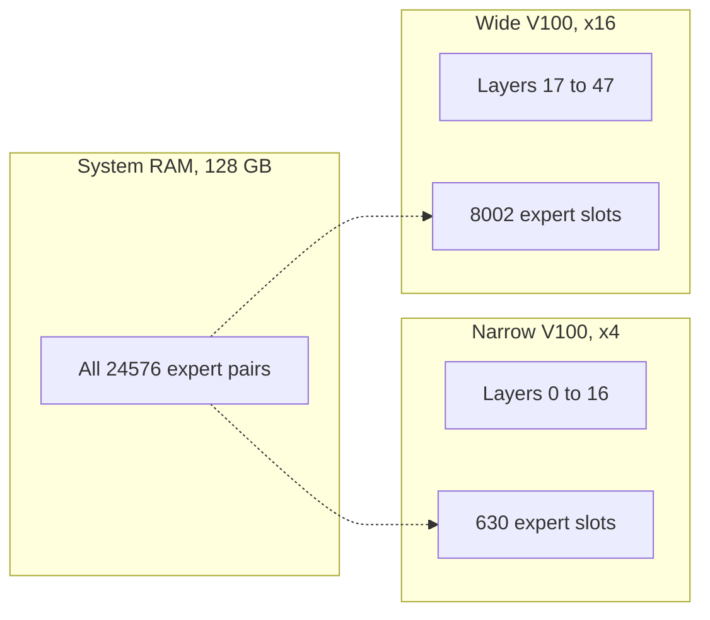
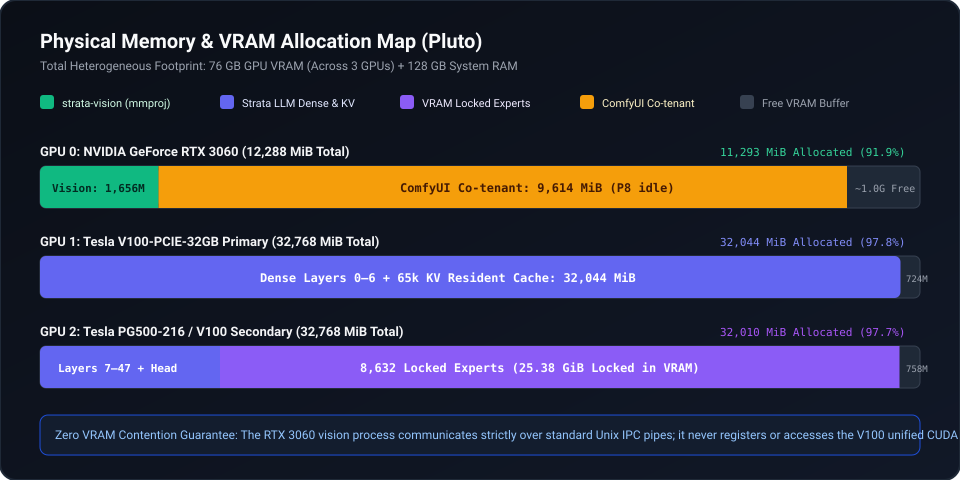
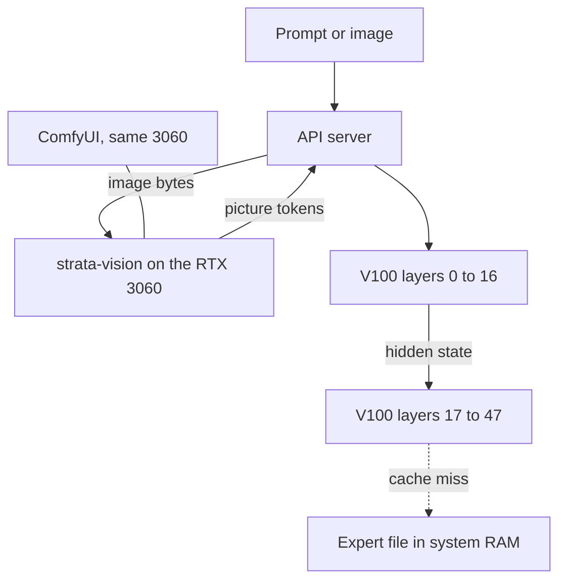
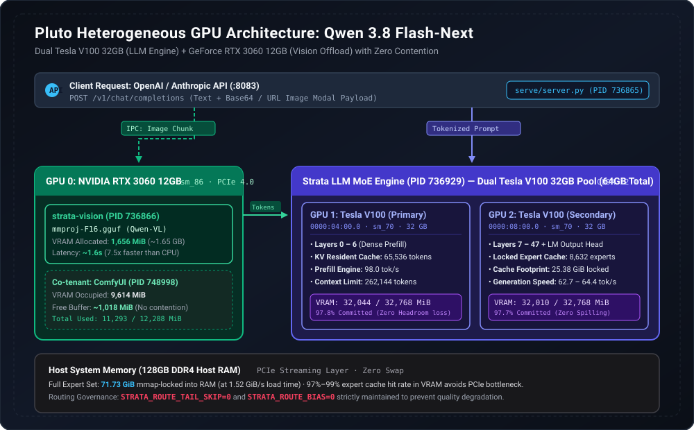
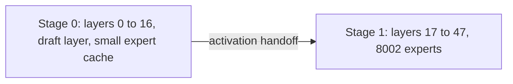
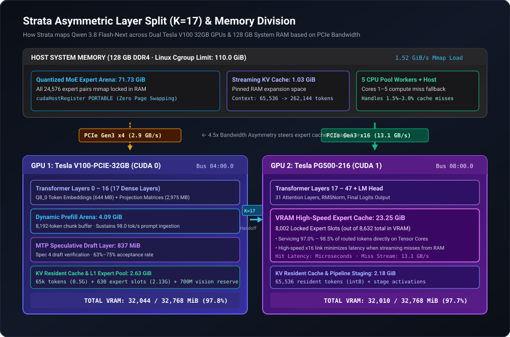
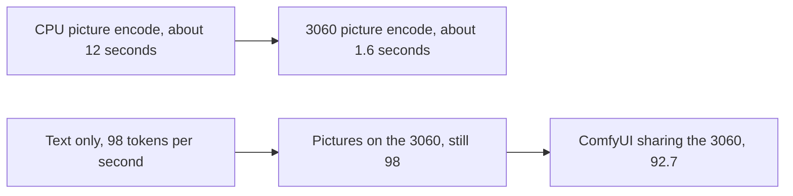
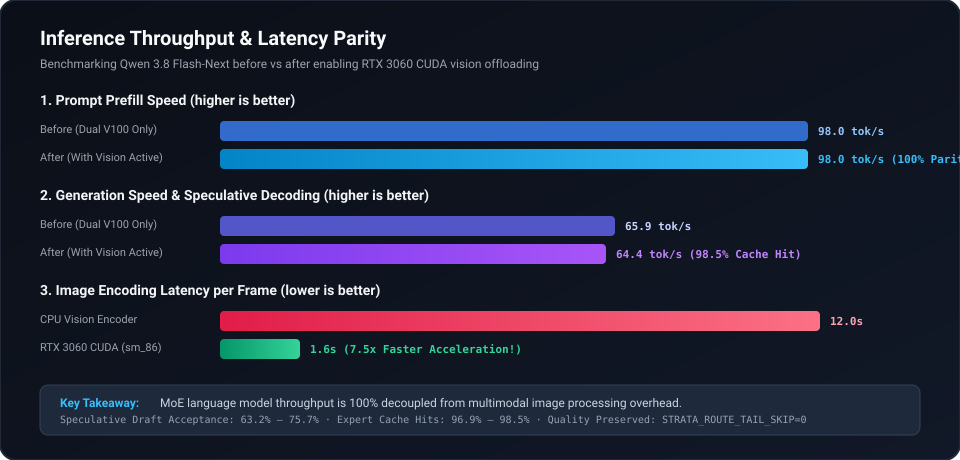

I have two old server graphics cards and one ordinary gaming card in the same box. The old cards are Tesla V100s, 32 GB each. The gaming card is an RTX 3060 with 12 GB. I wanted one local model that can read a picture and still write text at the same speed.

The diagrams and the measured numbers are in [strata-heterogeneous-v100-3060](https://github.com/CryptoJones/strata-heterogeneous-v100-3060). This post is the short version. The drawings below are the vector files from that repo. Drag to pan, scroll to zoom, or open the vector in its own tab.

> A **graphics card** here is a GPU, a chip built to do the same small math step on a huge pile of numbers. **VRAM** is the fast memory that sits on that card. If the numbers the model needs are in VRAM, the answer is quick. If they have to come across the slot from the rest of the computer, the answer waits.

## The model is big, and each word only uses a slice of it

The model is [Qwen3.8-Flash-Next](https://huggingface.co/Qwen/Qwen3.8-Flash-Next), from Alibaba's Qwen team. NVIDIA's public notes call it a vision-language mixture-of-experts model. About 125 billion stored numbers in total. About 6 billion of them are used for each token. The context window is 262,144 tokens.

> A **parameter** is one stored number inside the model. A **token** is a chunk of text, often a word or part of a word. A **mixture-of-experts** model, or MoE, keeps a lot of specialist blocks and only runs a few of them for each token. The whole file is huge. The work for one token is much smaller. A **context window** is how much text the model can hold in mind at once.

On my box the language model lives on the two V100s. Those chips are the 2017 Volta generation. CUDA calls that `sm_70`. Together they have 64 GB of VRAM. The running setup uses 32,044 MiB on one card and 32,010 MiB on the other, out of 32,768 MiB each. That is about 98 percent full.

What is locked in that memory:

- The dense transformer layers, split across the two cards.
- A key-value cache for 65,536 tokens, stored as 8-bit numbers. That is the part kept on the cards. The model can see a longer prompt than that. The box also keeps about 1 GiB pinned in system RAM so the context can grow toward the full 262,144 tokens.
- 8,632 cached experts, 25.38 GiB of them.

> A **transformer layer** is one pass of the model's main loop. This model has 48 of them. The **key-value cache**, or KV cache, is the memory of the conversation so far, so the model does not recompute every old token on every new word. An **expert** is one of those specialist blocks.

The weight file holds 24,576 expert pairs. All of them are mapped into system RAM, about 71.73 GiB. The 8,632 experts on the V100s are a cache of that same set, not a separate leftover pile. The box has 128 GB of system RAM. This setup uses about 73.5 GiB of it. A machine with 64 GB of system RAM does not have room for this file.

The two V100s are the same kind of card. Their slots are not the same, and the split follows the slots.

One card sits on a narrow PCI Express 3.0 x4 link. I measured that link at about 2.9 GB per second. It holds layers 0 through 16, a 4.09 GiB scratch area for reading the prompt, an 837 MiB draft layer, and only 630 expert slots (2.13 GiB).

The other card sits on a PCI Express 3.0 x16 link, measured at about 13.1 GB per second. The slot is four times as many lanes. The speed I measured is about 4.5 times higher. That card holds layers 17 through 47, the final output head, and 8,002 of the cached experts (23.25 GiB).

> **PCI Express**, or PCIe, is the slot between the card and the rest of the machine. More lanes means a wider road. A miss that has to fetch an expert from system RAM hurts less on the wide card, so that card keeps the big expert pile.

*The same split as a vector drawing from the repository. The wide card holds almost all of the cached experts.*

*The language model stays on the two V100s. The vision tool, and ComfyUI when it is open, stay on the 3060.*

The engine is [Strata](https://github.com/Niko1221/Strata), through the V100 port [Strata-V100](https://github.com/jmnargi/Strata-V100) and my fork [StraylightSprawl](https://github.com/CryptoJones/StraylightSprawl). The build on this box is Strata `0.1.43`. The machine is Debian 13, driver `580.159.04`, CUDA 12.9. The weights are Unsloth's `UD-Q4_K_XL` pack, a 4-bit file.

At startup, Strata measures the two links and prices the cost of a miss. On this box that measurement picked the split at layer 17, and it put the big expert cache on the wide card. You do not have to hard-code that split if your links look like mine. Measure them anyway, so you know why the engine chose what it chose.

*Layers 0 to 16 stay on the narrow card. Layers 17 to 47, and almost all of the cached experts, stay on the wide card.*

About 97 to 98 percent of tokens find their expert already in VRAM. The table below has the exact ranges. A miss, a few percent of tokens, is handled by five CPU worker threads or streamed over the wide link. The language model does not wait on the picture card.

The 837 MiB draft layer on the first V100 guesses four tokens ahead. That is the model's own multi-token prediction head, not a second model. On the vision run it was right on 108 of 171 guesses, about 63 percent. A shorter run, while another app shared the gaming card, was right on 28 of 37, about 76 percent. That second sample is only 37 guesses.

## Pictures were stealing memory

The model can also look at an image. The vision file, `mmproj-F16.gguf`, is about 904 MB on disk. Once it is loaded it uses 1,656 MiB of VRAM. That file turns a picture into tokens the language model can read.

Put that job on the V100s and you give up about 1.6 GB of expert cache. The hit rate falls, and the text slows down because the cards spend their time hauling weights across the slot. Leave the pictures on the CPU and each image costs about 12 seconds before the model starts its answer.

The 3060 was already in the box. It is an Ampere card, compute capability 8.6 (`sm_86`). I compiled Strata's existing vision tool, `strata-vision`, for that chip and told it to use only the 3060. The language model never opens that card. The server sends the image bytes to the vision tool on standard input. The vision tool sends the picture tokens back on standard output.

> Those two streams are a **Unix pipe**. No shared GPU memory. No second program inside the V100s' CUDA context. A **CUDA context** is one program's private view of a GPU. Separate processes on separate cards do not step on each other.

The result, on the same box:

| What I measured | Text only, two V100s | Pictures on the 3060 | Same 3060 also running ComfyUI |
| --- | --- | --- | --- |
| Reading the prompt | 98.0 tok/s | 98.0 tok/s | 92.7 tok/s |
| Writing the answer | 62.5 to 65.9 tok/s | 62.7 to 64.4 tok/s | 61.7 tok/s |
| Time to encode one image | about 12 s on the CPU | about 1.6 s | about 1.7 s |
| Expert cache hit rate | 97.7 to 98.5% | 96.9 to 98.1% | 96.5 to 97.2% |
| Experts locked in VRAM | 8,632 (25.38 GiB) | 8,632 (25.38 GiB) | 8,632 (25.38 GiB) |
| 3060 memory used | 9 MiB, idle | 1,656 MiB | 11,293 MiB |

Twelve seconds divided by 1.6 seconds is 7.5. That is the picture speedup. Moving vision to the 3060 left prompt reading at 98.0 tokens per second and answer writing at 62.7 to 64.4.

*Prompt speed stays flat when vision moves to the 3060. Sharing that card with ComfyUI costs a little.*

ComfyUI is a local image-generation app. I left it running on the same 3060. The diagram in the repo shows it at about 9,614 MiB, with the vision tool beside it. Together they used 11,293 MiB of the 12 GB card. Text got a little slower: 92.7 tokens per second to read the prompt, and 61.7 to write. Image encoding went from about 1.6 seconds to about 1.7. The V100 expert count stayed at 8,632.

## Two settings I turned off

Some Strata routing shortcuts make this model worse at tools and at careful writing. I keep both of these at zero:

- `STRATA_ROUTE_TAIL_SKIP` skips routing checks on the tail of a reply. Set to 7, it drops tool-call syntax and breaks tables.
- `STRATA_ROUTE_BIAS` pushes the router toward a favorite path and makes the speculative guesses worse.

## Why this box is still on 0.1.43

I looked at newer Strata-V100 commits, through `0.1.45.6`, and did not ship them. The write-up records two defects.

One upstream change put a memory copy inside a check these Volta cards do not pass. The copy never runs, and routing breaks on `sm_70`. A server change added a broad guess for "this looks like a tool call," and it fires on ordinary sentences.

The running build stays at `0.1.43`, the one these numbers were measured on.

## What to copy

If one card is already full of a language model, and a second card can see, run vision as its own process on the second card. The file is 904 MB on disk and 1,656 MiB once loaded. Do not take that 1.6 GB out of the expert cache.

Do not copy a narrow slot on purpose. One of these V100s is stuck at x4, so the expert cache sits on the x16 card. That is the card that can pay for a miss. If both of your cards have the same width, a more even split can make sense.

The build flags and the config file are in the [repository](https://github.com/CryptoJones/strata-heterogeneous-v100-3060). Use your own paths, your own GPU numbers, and your own API key.

These numbers are one Debian box and one model pack. They are not a promise for a different pair of cards.
